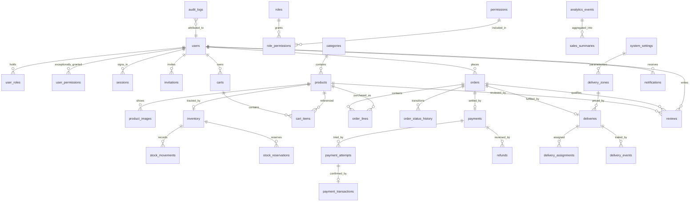

# Phase 1 — Domain Model, PostgreSQL ERD and Transaction Boundaries

**Implements:** §19 step 3, §12 step 4, §7 (bounded contexts), §9 (data strategy and
modelling rules), §10 (security), §11 (API standards).
**Depends on:** `docs/adr/ADR-015-023-open-item-resolutions.md`,
`docs/phase-1-actor-permission-matrix.md`.
**Status:** Draft for review. §13's Phase 1 exit criterion is "domain language, schema draft
and API contract reviewed" — all three now exist (`contracts/openapi.yaml` is step 4), and the
decisions that gated them were ratified on 2026-11-05 except ADR-018's delivery terms.

---

## 1. Modelling rules applied (§9)

| Rule | How it is honoured here |
|---|---|
| Primary keys, foreign keys, unique, CHECK and indexes enforce integrity | Every table below declares them; no integrity rule is left to application code |
| Money as integer minor units, never floating point | See §2 |
| JSONB selectively, never for whole entities | JSONB only for product specifications, provider payloads, and settings values. `orders.items` JSONB is **abolished** in favour of `order_lines` |
| Timestamps UTC in database and application; present local in `Africa/Nairobi` | All columns `timestamptz`; presentation conversion is a display-layer concern only |
| Append-only stock movement and audit history; corrections via compensating entries | `stock_movements` and `audit_logs` have `UPDATE`/`DELETE` revoked from the application role — enforced in the database, not by convention |
| Indexes from real query patterns | See §8 |
| pgvector only if justified | **Not used.** No semantic-search or recommendation requirement exists |

---

## 2. Money and rounding

All monetary values are `BIGINT` count of **cents** (`amount_cents`, `price_cents`,
`fee_cents`), with `CHECK (… >= 0)` on every amount that cannot legitimately be negative and
`CHECK (… <> 0)` where a zero would indicate a bug. Currency is fixed to `KES` and stored
only where a record could conceivably travel — a single-currency shop does not need a
currency column on every row, so it appears on `system_settings` and in
`payment_transactions` where the provider supplies one.

**The whole-shilling constraint.** Daraja STK Push requires a whole-number amount
(`Math.ceil` in the current code, `mpesa.js:65`). To make the amount owed and the amount
charged always identical rather than always approximately identical:

```sql
CHECK (price_cents % 100 = 0)     -- on products
```

Product prices are entered in whole shillings. Order line totals and order totals are
therefore whole shillings by construction, and `amount_cents / 100` is exactly the figure
sent to Daraja. Percentage discounts are computed in cents and **rounded half-up to the
nearest whole shilling at order creation**, then snapshotted onto the line — so the rounding
decision is made once, is recorded, and never has to be reproduced from floating-point
arithmetic later.

If the business ever needs sub-shilling pricing, this constraint is the thing to revisit.
Recorded as **ADR-021** (Accepted).

---

## 3. Domain model — bounded contexts and language

Eleven contexts from §7. Domain objects are named as the document names them.

| Context | Aggregate root | Notable members | Invariant the root protects |
|---|---|---|---|
| **Identity & Access** | `User` | `Role`, `Permission`, `Session`, `Invitation` | A user's effective permissions are the union of role permissions plus audited exceptional grants; a revoked membership takes effect on the next authorisation check |
| **Catalogue** | `Product` | `Category`, `ProductImage`, `SKU`, `ProductSpecification`, `PublicationState` | `sku` and `slug` are unique; `publication_state` governs storefront visibility **independently of** stock status — these were conflated in the current model, which has no publication state at all |
| **Shopping** | `Cart` | `CartItem`, `PricingSnapshot` | A cart line records the price it was added at; the total charged is always recomputed at checkout, never taken from the cart |
| **Ordering** | `Order` | `OrderLine`, `OrderStatus`, `Lifecycle`, `Totals` | Status moves only along the ADR-015 transition table; totals are derived from lines, never assigned |
| **Payments** | `Payment` | `PaymentAttempt`, `PaymentTransaction`, `Refund`, `DarajaCallback` | Exactly one settlement per `CheckoutRequestID`; `amount_paid` must equal `amount_owed` for a payment to be `paid` |
| **Inventory** | `StockItem` | `StockMovement`, `StockReservation` | `reserved <= on_hand`; `on_hand >= 0`; every change to `on_hand` has exactly one corresponding `StockMovement` |
| **Fulfilment** | `Delivery` | `DeliveryZone`, `DeliveryAssignment`, `DeliveryEvent`, `PickupWindow` | A delivery's state trail is append-only; fee charged is snapshotted at order creation |
| **Customer Engagement** | `Review` | `Notification`, `Subscriber`, `NotificationPreference` | A review requires a delivered order containing the product (ADR-017); product rating aggregates are derived, never authored |
| **Promotions** | `Campaign` | `Coupon`, `DiscountRule`, `Eligibility` | Deferred — see §9. Shape reserved, no launch behaviour depends on it |
| **Analytics & Intelligence** | `SalesSummary` | `AnalyticsEvent`, `ForecastRun`, `Target`, `Threshold` | Snapshots are recomputable from source tables; a snapshot is a cache, never the truth |
| **Administration & Audit** | `AuditLog` | `SystemSetting`, `IntegrationHealthCheck`, `BackgroundJob` | Append-only; no role may alter or delete an entry; every privileged action in the matrix's "audit: mandatory" rows lands here |

### Naming decisions recorded

- `shipped` is retired; `dispatched` replaces it (ADR-015).
- `messages` (live table) and `contact_messages` (dead schema file) collapse to **`inquiries`**,
  removing the two-name ambiguity documented in the inventory §7.2.
- `admins` and the absent `users` collapse into a single **`users`** table with role
  assignments, per §9's identity group listing.
- `status` on products splits into `publication_state` and `stock_status`.

---

## 4. ERD — overview



---

## 5. Schema by context

Schema grouping follows §9's logical table groups. PostgreSQL schemas are used rather than
table-name prefixes, so `identity.users`, `commerce.orders`, and a Go repository per context
maps cleanly onto §7's module layout.

### 5.1 `identity`

```sql
users(id BIGSERIAL PK, email CITEXT UNIQUE NOT NULL, phone VARCHAR(20) UNIQUE,
      full_name TEXT NOT NULL, password_hash TEXT NOT NULL,      -- Argon2id, ADR-019
      account_kind TEXT NOT NULL CHECK (account_kind IN ('customer','admin')),
      is_active BOOLEAN NOT NULL DEFAULT true,
      is_suspended BOOLEAN NOT NULL DEFAULT false,
      email_verified_at TIMESTAMPTZ, phone_verified_at TIMESTAMPTZ,
      last_login_at TIMESTAMPTZ, created_at, updated_at)

roles(id BIGSERIAL PK, key CITEXT UNIQUE NOT NULL,               -- 'admin_2_operations'
      name TEXT NOT NULL, description TEXT, is_system BOOLEAN)   -- is_system: cannot be deleted

permissions(id BIGSERIAL PK, key CITEXT UNIQUE NOT NULL,         -- 'catalogue.products.update_price'
      context TEXT NOT NULL, description TEXT)

user_roles(user_id → users, role_id → roles, granted_by → users, granted_at,
           PRIMARY KEY (user_id, role_id))

role_permissions(role_id → roles, permission_id → permissions,
                 PRIMARY KEY (role_id, permission_id))

-- §3: "a user may receive permissions through an assigned role, with any exceptional
-- assignment explicitly audited." This table is the exceptional path and it is justified
-- by a mandatory reason, not left nullable.
user_permissions(user_id → users, permission_id → permissions,
                 granted_by → users NOT NULL, reason TEXT NOT NULL, granted_at,
                 expires_at TIMESTAMPTZ,                        -- exceptional grants expire
                 PRIMARY KEY (user_id, permission_id))

sessions(id BIGSERIAL PK, session_hash TEXT UNIQUE NOT NULL,     -- hash of the opaque id
         user_id → users, ip INET, user_agent TEXT,
         created_at, last_seen_at, expires_at, revoked_at,
         replaced_by_session_id)                                 -- rotation lineage

invitations(id BIGSERIAL PK, email CITEXT NOT NULL, invite_token_hash TEXT UNIQUE,
            invited_role_id → roles, scope JSONB,
            invited_by → users, status TEXT CHECK (status IN
              ('pending','accepted','expired','revoked')),
            created_at, expires_at, accepted_at)
```

### 5.2 `catalogue`

```sql
categories(id BIGSERIAL PK, name TEXT NOT NULL, slug CITEXT UNIQUE NOT NULL,
           icon TEXT, parent_id → categories NULL,               -- hierarchy exists today only
           is_active BOOLEAN, created_at)                         --   in the dead schema file

products(id BIGSERIAL PK,
         sku CITEXT UNIQUE NOT NULL,        -- absent from the current model entirely
         name TEXT NOT NULL, slug CITEXT UNIQUE NOT NULL,
         description TEXT, brand TEXT,
         price_cents BIGINT NOT NULL CHECK (price_cents >= 0 AND price_cents % 100 = 0),
         compare_at_price_cents BIGINT NULL CHECK (... % 100 = 0),  -- replaces the invented
                                                                     -- "original price" in ProductCard
         category_id → categories NOT NULL, subcategory TEXT,
         publication_state TEXT NOT NULL DEFAULT 'draft' CHECK (publication_state IN
           ('draft','published','unpublished','archived')),
         is_featured BOOLEAN DEFAULT false,
         specifications JSONB NOT NULL DEFAULT '{}'::jsonb,   -- §9: variable specs only
         views INTEGER NOT NULL DEFAULT 0 CHECK (views >= 0),
         rating_avg NUMERIC(3,2) NOT NULL DEFAULT 0,          -- DERIVED, see §5.7
         rating_count INTEGER NOT NULL DEFAULT 0,             -- DERIVED
         created_at, updated_at, published_at, archived_at)

CREATE INDEX ON catalogue.products (category_id) WHERE publication_state = 'published';
CREATE INDEX ON catalogue.products USING gin (to_tsvector('simple', name || ' ' ||
        coalesce(description,'') || ' ' || coalesce(subcategory,'')));   -- §9: full-text
CREATE UNIQUE INDEX ON catalogue.products (lower(sku));                   -- before: no SKU at all

product_images(id BIGSERIAL PK, product_id → products ON DELETE CASCADE,
               url TEXT NOT NULL, alt_text TEXT, position INTEGER,
               provider TEXT NOT NULL DEFAULT 'local',   -- 'local' | 'cloudinary'
               provider_ref TEXT, is_primary BOOLEAN, created_at,
               UNIQUE (product_id, url))
-- One primary image per product, enforced in the database:
CREATE UNIQUE INDEX ON catalogue.product_images (product_id) WHERE is_primary;
```

`views` increments are moved out of the read path (see §7, transaction T-09) — the current
design writes to the row on every GET, which turns a cacheable read into a write.

### 5.3 `commerce`

```sql
carts(id BIGSERIAL PK, user_id → users NULL,          -- NULL = guest cart
      session_token_hash TEXT NULL,                    -- ties a guest cart to a browser
      created_at, updated_at, merged_into_cart_id)
-- A guest cart is merged into the user's cart at registration/login rather than abandoned.

cart_items(cart_id → carts ON DELETE CASCADE, product_id → products,
          quantity INTEGER NOT NULL CHECK (quantity > 0),
          added_at, price_snapshot_cents BIGINT NOT NULL,
          PRIMARY KEY (cart_id, product_id))

orders(id BIGSERIAL PK,
       reference TEXT UNIQUE NOT NULL,   -- generated by a sequence, NOT count(*)+1 (inv. §5.4)
       customer_id → users NULL,
       customer_name TEXT NOT NULL, customer_phone VARCHAR(20) NOT NULL,
       customer_email CITEXT,
       fulfilment_method TEXT NOT NULL CHECK (fulfilment_method IN ('pickup','delivery')),
       status TEXT NOT NULL DEFAULT 'pending' CHECK (status IN
         ('pending','confirmed','processing','ready','dispatched','delivered',
          'cancelled','returned','refunded','expired')),
       subtotal_cents BIGINT NOT NULL CHECK (subtotal_cents >= 0),
       delivery_fee_cents BIGINT NOT NULL DEFAULT 0 CHECK (delivery_fee_cents >= 0),
       discount_cents BIGINT NOT NULL DEFAULT 0 CHECK (discount_cents >= 0),
       total_cents BIGINT NOT NULL CHECK (total_cents >= 0),
       -- The invariant that makes the current client-authoritative total impossible:
       CONSTRAINT totals_reconcile CHECK (
         total_cents = subtotal_cents + delivery_fee_cents - discount_cents),
       notes TEXT, cancel_reason TEXT, cancelled_at,
       created_at, updated_at, placed_at, expires_at)   -- payment window (ADR-015)

CREATE INDEX ON commerce.orders (status, created_at DESC);
CREATE INDEX ON commerce.orders (customer_id, created_at DESC);
CREATE UNIQUE INDEX ON commerce.orders (upper(reference));

-- Abolishes the JSONB `orders.items` blob (inventory §7.1)
order_lines(id BIGSERIAL PK, order_id → orders ON DELETE CASCADE,
            product_id → products NOT NULL,
            product_name TEXT NOT NULL,        -- snapshot: survives product edits and deletes
            sku TEXT NOT NULL,                 -- snapshot
            unit_price_cents BIGINT NOT NULL,  -- immutable (ADR-016)
            quantity INTEGER NOT NULL CHECK (quantity > 0),
            line_total_cents BIGINT NOT NULL,
            CONSTRAINT line_total_is_exact CHECK
              (line_total_cents = unit_price_cents * quantity),
            created_at)
CREATE INDEX ON commerce.order_lines (order_id);
CREATE INDEX ON commerce.order_lines (product_id);   -- "what sold", for inventory analytics

-- Append-only. Never updated.
order_status_history(id BIGSERIAL PK, order_id → orders,
      from_status TEXT NULL, to_status TEXT NOT NULL,
      actor_id → users NULL,                 -- NULL = system (expiry job, callback)
      system_trigger TEXT NULL,              -- 'daraja_callback' | 'reservation_expiry' …
      reason TEXT, occurred_at TIMESTAMPTZ NOT NULL DEFAULT now(),
      -- ADR-015 rule 8: a non-adjacent move requires an override, which requires a reason.
      CONSTRAINT override_needs_reason CHECK (
        reason IS NOT NULL OR from_status IS NULL OR system_trigger IS NOT NULL))
```

### 5.4 `payments`

```sql
payments(id BIGSERIAL PK, order_id → orders UNIQUE NOT NULL,
         amount_owed_cents BIGINT NOT NULL CHECK (amount_owed_cents > 0),
         amount_paid_cents BIGINT NULL CHECK (amount_paid_cents >= 0),
         status TEXT NOT NULL DEFAULT 'pending' CHECK (status IN
           ('pending','paid','failed','expired','refunded')),
         settled_at TIMESTAMPTZ, created_at, updated_at,
         -- The rule ADR-015 depends on: paid only when the amount matches exactly.
         CONSTRAINT paid_requires_exact_amount CHECK (
           status <> 'paid' OR amount_paid_cents = amount_owed_cents))

payment_attempts(id BIGSERIAL PK, payment_id → payments,
         provider TEXT NOT NULL DEFAULT 'daraja',
         provider_request_id TEXT UNIQUE,     -- CheckoutRequestID — the idempotency anchor
         phone_e164 VARCHAR(15) NOT NULL,
         amount_requested_cents BIGINT NOT NULL,
         status TEXT NOT NULL CHECK (status IN
           ('initiated','pending','succeeded','failed','unknown')),
         result_code TEXT, result_desc TEXT,
         initiated_by → users NULL,           -- NULL = guest checkout
         created_at, updated_at,
         CHECK (amount_requested_cents % 100 = 0))   -- whole shillings, from server total
CREATE INDEX ON payments.payment_attempts (payment_id, created_at DESC);

-- One row per verified provider transaction. UNIQUE is what makes a replayed callback a
-- no-op instead of a second settlement (inventory §4.3, matrix A-003).
payment_transactions(id BIGSERIAL PK, attempt_id → payment_attempts,
         provider_transaction_id TEXT UNIQUE NOT NULL,   -- MpesaReceiptNumber
         amount_paid_cents BIGINT NOT NULL,
         result_code TEXT NOT NULL, result_desc TEXT,
         phone_e164 VARCHAR(15),
         raw_payload JSONB NOT NULL,          -- §9: provider payload in JSONB, selectively
         received_at TIMESTAMPTZ NOT NULL,
         source_verified BOOLEAN NOT NULL,    -- ADR-019 callback verification result
         verified_at TIMESTAMPTZ)

refunds(id BIGSERIAL PK, payment_id → payments, order_id → orders,
        requested_by → users NOT NULL, approved_by → users NULL,
        amount_cents BIGINT NOT NULL CHECK (amount_cents > 0),
        reason TEXT NOT NULL,
        status TEXT NOT NULL DEFAULT 'requested' CHECK (status IN
          ('requested','approved','executed','rejected')),
        provider_reference TEXT NULL,         -- filled when a human executes it (ADR-020)
        executed_at TIMESTAMPTZ, rejected_reason TEXT,
        created_at, updated_at,
        -- A refund cannot exceed what was paid:
        CONSTRAINT refund_within_paid CHECK (amount_cents <= /* subquery enforced in use case */ 0))
-- The cross-table bound cannot be a CHECK constraint; it is enforced in the Refund use case
-- inside the same transaction, and covered by a test. Recorded here so the reviewer sees
-- that the gap is deliberate, not overlooked.
CREATE INDEX ON payments.refunds (order_id);
```

### 5.5 `inventory`

```sql
-- Separate from products. §7 names StockItem as its own domain object, and the current
-- design (stock_quantity as a column on the product document) makes the overselling
-- in inventory §5.1 unavoidable.
inventory(id BIGSERIAL PK, product_id → products UNIQUE NOT NULL,
         on_hand INTEGER NOT NULL DEFAULT 0 CHECK (on_hand >= 0),
         reserved INTEGER NOT NULL DEFAULT 0 CHECK (reserved >= 0),
         available INTEGER GENERATED ALWAYS AS (on_hand - reserved) STORED,
         reorder_point INTEGER,              -- replaces the hardcoded 5 / 2 thresholds
         low_stock_threshold INTEGER NOT NULL DEFAULT 5,
         critical_stock_threshold INTEGER NOT NULL DEFAULT 2,
         updated_at,
         CHECK (reserved <= on_hand))        -- overselling is impossible at the row level
CREATE INDEX ON inventory.inventory (available) WHERE available <= low_stock_threshold;

stock_reservations(id BIGSERIAL PK, order_id → orders, product_id → products,
         quantity INTEGER NOT NULL CHECK (quantity > 0),
         status TEXT NOT NULL DEFAULT 'active' CHECK (status IN
           ('active','consumed','released','expired')),
         expires_at TIMESTAMPTZ NOT NULL,
         created_at, resolved_at,
         -- One reservation per order line, so release is idempotent by construction:
         UNIQUE (order_id, product_id))
CREATE INDEX ON inventory.stock_reservations (status, expires_at);  -- the expiry sweep

-- APPEND-ONLY. UPDATE and DELETE revoked from the application role.
stock_movements(id BIGSERIAL PK, product_id → products NOT NULL,
         change INTEGER NOT NULL CHECK (change <> 0),
         on_hand_after INTEGER NOT NULL CHECK (on_hand_after >= 0),
         reason_type TEXT NOT NULL CHECK (reason_type IN
           ('sale','reservation','reservation_release','return','adjustment',
            'opening_balance','correction')),
         reference_type TEXT, reference_id BIGINT,   -- order / adjustment / job
         actor_id → users NULL, system_trigger TEXT,
         reason_note TEXT,
         occurred_at TIMESTAMPTZ NOT NULL DEFAULT now())
-- Corrections are new rows, never edits (§9). ADR-005's acceptance test depends on this.
CREATE INDEX ON inventory.stock_movements (product_id, occurred_at DESC);
```

### 5.6 `fulfilment`

```sql
delivery_zones(id BIGSERIAL PK, name TEXT NOT NULL, slug CITEXT UNIQUE,
         fee_cents BIGINT NOT NULL CHECK (fee_cents >= 0 AND fee_cents % 100 = 0),
         lead_time_hours INTEGER NOT NULL DEFAULT 24,
         is_active BOOLEAN NOT NULL DEFAULT true, notes TEXT, created_at, updated_at)

deliveries(id BIGSERIAL PK, order_id → orders UNIQUE NOT NULL,
         zone_id → delivery_zones NULL,      -- NULL for pickup orders
         address_line TEXT, area TEXT, county TEXT,
         contact_name TEXT NOT NULL, contact_phone VARCHAR(20) NOT NULL,
         fee_charged_cents BIGINT NOT NULL DEFAULT 0,   -- snapshot at order creation
         promised_window_start TIMESTAMPTZ, promised_window_end TIMESTAMPTZ,
         pickup_window_start TIMESTAMPTZ, pickup_window_end TIMESTAMPTZ,
         status TEXT NOT NULL DEFAULT 'awaiting_assignment' CHECK (status IN
           ('awaiting_assignment','assigned','preparing','ready_for_pickup',
            'in_transit','delivered','failed_attempt','returned_to_store','cancelled')),
         created_at, updated_at)

delivery_assignments(id BIGSERIAL PK, delivery_id → deliveries,
         assigned_to → users NULL, rider_name TEXT, vehicle_note TEXT,
         assigned_by → users NOT NULL, assigned_at, released_at)

delivery_events(id BIGSERIAL PK, delivery_id → deliveries,
         from_status TEXT, to_status TEXT NOT NULL,
         actor_id → users NULL, note TEXT, occurred_at)     -- append-only trail

store_hours(id BIGSERIAL PK, weekday SMALLINT NOT NULL CHECK (weekday BETWEEN 0 AND 6),
         method TEXT NOT NULL CHECK (method IN ('pickup','delivery')),
         opens_at TIME, closes_at TIME, is_open BOOLEAN NOT NULL,
         same_day_cutoff TIME NULL,
         timezone TEXT NOT NULL DEFAULT 'Africa/Nairobi',   -- ADR-018: never device clock
         UNIQUE (weekday, method))
```

### 5.7 `engagement`

```sql
reviews(id BIGSERIAL PK, product_id → products NOT NULL,
        customer_id → users NOT NULL,        -- free-text `name` column abolished
        order_id → orders NOT NULL,          -- the ADR-017 eligibility proof
        rating SMALLINT NOT NULL CHECK (rating BETWEEN 1 AND 5),
        title TEXT, comment TEXT,
        status TEXT NOT NULL DEFAULT 'pending' CHECK (status IN
          ('pending','approved','rejected')),
        approved_by → users NULL, approved_at, rejection_reason TEXT,
        created_at, updated_at,
        -- ADR-017 rule 4: one review per product per customer.
        UNIQUE (product_id, customer_id),
        -- Eligibility window is evaluated in the use case against order.delivered_at,
        -- because a CHECK cannot reference another table.
        delivered_at_snapshot TIMESTAMPTZ NOT NULL)

-- Derived aggregates, recomputed on approve/reject. Replaces the string-producing
-- .toFixed(1) path in index.js:436.
CREATE OR REPLACE FUNCTION catalogue.sync_product_rating(review_product_id BIGINT) ...
  -- UPDATE products SET rating_avg = ROUND(AVG(rating)::numeric, 2),
  --                    rating_count = COUNT(*) WHERE status='approved'

notifications(id BIGSERIAL PK, user_id → users, kind TEXT, title TEXT, body TEXT,
        reference_type TEXT, reference_id BIGINT, read_at TIMESTAMPTZ, created_at)

notification_preferences(user_id → users, channel TEXT, event_kind TEXT, enabled BOOLEAN,
        PRIMARY KEY (user_id, channel, event_kind))

subscribers(id BIGSERIAL PK, email CITEXT UNIQUE NOT NULL, name TEXT,
        is_active BOOLEAN DEFAULT true, consent_source TEXT,   -- §18 privacy item
        consented_at TIMESTAMPTZ, subscribed_at, unsubscribed_at)

inquiries(id BIGSERIAL PK, name TEXT NOT NULL, phone VARCHAR(20), email CITEXT,
        message TEXT NOT NULL, is_read BOOLEAN DEFAULT false,
        responded_at TIMESTAMPTZ, responded_by → users NULL, created_at)
        -- Renamed from `messages`; the dead schema file called it contact_messages.
```

### 5.8 `analytics`

Retains the five live tables from `initPg.js` with renamed, typed equivalents, plus §9's
`analytics_events`, `sales_summaries`, `forecast_runs`:

`analytics.events` (append-only, the SSE/audit feed), `analytics.daily_snapshots`
(recomputable cache), `analytics.sales_summaries`, `analytics.targets`,
`analytics.thresholds`, `analytics.alerts`, `analytics.forecast_runs`,
`analytics.product_sales_velocity`.

**Revenue definition — resolved as ADR-022 (Accepted, 2026-11-05).** Revenue is
*Σ `payments.amount_paid_cents` where `payments.status='paid'`, minus Σ `refunds.amount_cents`
where `refunds.status='executed'`, attributed to the period of settlement or execution — not
the period of order creation.* The current rule `payment_status='paid' OR status='delivered'`
books unpaid delivered orders as revenue (inventory §5.5) and is discarded, not ported.

Consequence for this schema: `analytics.daily_snapshots` and `analytics.sales_summaries` key on
`payments.settled_at` and `refunds.executed_at`, and **cannot** be derived from
`orders.created_at`. A dashboard card grouped by order date is an order count, not revenue, and
must be labelled that way.

### 5.9 `administration`

```sql
audit_logs(id BIGSERIAL PK, actor_id → users NULL, actor_kind TEXT NOT NULL,
        action TEXT NOT NULL,                 -- permission key or system action
        resource_type TEXT, resource_id BIGINT,
        previous_value JSONB, new_value JSONB, reason TEXT,
        ip INET, correlation_id TEXT,         -- §10: structured logs, correlation IDs
        occurred_at TIMESTAMPTZ NOT NULL DEFAULT now())
-- APPEND-ONLY. UPDATE/DELETE revoked. Covers every "audit: mandatory" row in the matrix:
-- price changes, stock adjustments, payment overrides, order transitions, role changes,
-- invitations, exceptional permission grants, refund approvals.
CREATE INDEX ON administration.audit_logs (actor_id, occurred_at DESC);
CREATE INDEX ON administration.audit_logs (resource_type, resource_id);

system_settings(key CITEXT PK, value JSONB NOT NULL, description TEXT,
        updated_by → users, updated_at)
-- Seeds: delivery_standard_fee_cents=15000, free_delivery_threshold_cents=60000,
--        currency='KES', low_stock_limit=5, critical_stock_limit=2, dead_stock_days=30,
--        reservation_ttl_minutes=30, stuck_order_minutes=30, fulfillment_delay_hours=48
-- These values exist today only inside a JSONB blob (initPg.js:131-142) and as hardcoded
-- literals in two route handlers. Here they are one row each, individually editable.

integration_health_checks(id BIGSERIAL PK, provider TEXT, status TEXT, detail TEXT,
        checked_at, next_check_at)

outbox_events(id BIGSERIAL PK, aggregate_type TEXT, aggregate_id BIGINT,
        event_type TEXT, payload JSONB, occurred_at,
        published_at TIMESTAMPTZ NULL, attempts INTEGER DEFAULT 0, last_error TEXT)
-- Written in the SAME transaction as the state change, then relayed to email/SSE/queue by a
-- background worker. This is what makes §11's "background jobs for email and notifications"
-- and §10's "audit … payment reconciliation" possible without the current fire-and-forget
-- `.catch(console.warn)` pattern that silently loses every email (inventory §8.2).
CREATE INDEX ON administration.outbox_events (published_at) WHERE published_at IS NULL;
```

---

## 6. What changes relative to the live database

| Today | Target | Why |
|---|---|---|
| `products`, `categories`, `reviews` in **MongoDB** | same three in `catalogue` / `engagement` in Postgres | ADR-001; and inventory §5.2 — stock and orders cannot share a transaction across two engines |
| `orders.items` JSONB blob | `order_lines` | Line-level reporting, per-line price snapshot, per-line reservation, refund by line |
| `orders.total_amount` assigned by the client | `total_cents` + `totals_reconcile` CHECK | Inventory §4.5 — client-supplied totals |
| `orders.payment_status` column | `payments` + `payment_attempts` + `payment_transactions` | A single status column cannot express per-attempt idempotency (ADR-020 consequence in inventory §4.3) |
| `stock_quantity` on the product row | `inventory` + `stock_movements` + `stock_reservations` | Inventory §5.1/5.3 — overselling and double-restore-on-cancel |
| `orders.status` free text, no constraint | `status` with CHECK + `order_status_history` | ADR-015 |
| `admins` table, `password` column | `users` + `roles` + `permissions` | ADR-013; the column is also renamed to `password_hash` so a plaintext value cannot be written by accident |
| `messages` | `inquiries` | Two names for one table across the live schema and the dead schema file |
| No `users`, no customers, no sessions | `identity` in full | The Customer actor does not exist today (inventory §6.1) |
| No publication state on products | `publication_state` | §5 workflow step 4 requires visibility to follow publication state |
| No `sku` anywhere | `sku UNIQUE NOT NULL` | §5 workflow step 2 requires SKU uniqueness |
| Thresholds inside one JSONB blob + hardcoded literals | `system_settings` rows + `inventory` columns | Three sources of truth for "low stock" (inventory §10) |
| Nothing expires | `orders.expires_at`, `stock_reservations.expires_at` | §12 step 6 expiry/release rules |

---

## 7. Transaction boundaries

This is the part §19 step 3 asks for explicitly. Each entry names the tables written, the
concurrency control, the idempotency key, and what happens on failure. **One use case = one
transaction.** No notification, email or SSE write happens inside a transaction — they go
through `outbox_events`.

### T-01 · Place order
**Writes:** `commerce.orders`, `commerce.order_lines`, `inventory.stock_reservations`,
`inventory.stock_movements` (reason `reservation`), `administration.outbox_events`.
**Concurrency:** for each line, in **ascending `product_id` order** (deterministic ordering
prevents the deadlock that two multi-line carts would otherwise create):
```sql
UPDATE inventory.inventory
   SET reserved = reserved + $qty, updated_at = now()
 WHERE product_id = $pid
   AND on_hand - reserved >= $qty;
-- rows affected = 0  ⇒  insufficient stock  ⇒  ROLLBACK the whole order
```
No `SELECT … FOR UPDATE` is needed: the conditional update is atomic and the row count tells
the truth. `reserved <= on_hand` is the belt-and-braces CHECK.
**Idempotency:** client supplies an `Idempotency-Key` header; a repeat with the same key
returns the original order rather than creating a second one.
**Failure:** any line short → rollback, report which product; cart price differs from
current price → surface the change for confirmation, do not silently re-price.
**Result:** order `pending`, stock reserved, `expires_at = now() + reservation_ttl`.

### T-02 · Initiate STK Push
**Writes:** `payments.payment_attempts`, `administration.outbox_events`.
**Reads:** `payments.amount_owed_cents` — the amount **never** comes from the request
(inventory §4.6).
**Concurrency:** a maximum of one attempt in status `initiated|pending` per payment; a
second request returns the existing attempt rather than double-prompting the phone.
**Failure:** Daraja error → attempt recorded `failed`, order untouched, stock still reserved.
**Note:** the OAuth token is fetched per request today (`mpesa.js:17`, no caching). The Go
adapter caches it against its ~1-hour validity; this is an adapter concern, not a schema one.

### T-03 · Apply verified callback — *the critical boundary*
**Writes:** `payments.payment_transactions`, `payments`, `commerce.orders.status`,
`commerce.order_status_history`, `inventory.stock_reservations` (→`consumed`),
`inventory.stock_movements` (reason `sale`), `administration.audit_logs`,
`administration.outbox_events`.
**Idempotency, in order:**
1. `INSERT … payment_transactions` with `provider_transaction_id` (MpesaReceiptNumber) —
   a **unique violation means this callback was already applied**; commit the ACK and stop.
2. Locate the order by `payment_attempts.provider_request_id` (CheckoutRequestID) **only**.
   The phone-suffix fallback (inventory §4.4) is deleted with no replacement.
3. Guard: `UPDATE payments SET status='paid' … WHERE id=$1 AND status IN ('pending','expired')`
   — zero rows affected means already settled; no-op.
4. Amount check: `amount_paid_cents = amount_owed_cents` or the `paid_requires_exact_amount`
   CHECK refuses the transition; a mismatch stores the transaction, leaves the payment
   `pending`, and raises an alert for reconciliation.
**Failure:** any step errors → full rollback; the callback still ACKs to Safaricom so they
stop retrying, and the reconciliation job picks the discrepancy up afterwards.
**Result:** exactly one settlement, exactly one stock commit, exactly one confirmation email
in the outbox — regardless of how many times Safaricom delivers the payload.

### T-04 · Cancel order
**Writes:** `orders` (status + `cancel_reason`), `order_status_history`,
`stock_reservations` (→`released`), `stock_movements` (reason `reservation_release`),
`audit_logs`, `outbox_events`.
**Idempotency:** the reservation's `UNIQUE (order_id, product_id)` plus status guard means a
second cancel finds nothing `active` to release. This is the fix for inventory §5.3, where
cancelling twice added stock twice.

### T-05 · Reservation expiry sweep *(background job)*
Selects reservations where `status='active' AND expires_at < now()`, locks with
`FOR UPDATE SKIP LOCKED` so multiple workers cannot race, and per order runs T-04's release
path with `system_trigger='reservation_expiry'` and order status →`expired`.
This is the first real scheduled job in the system; §8.3 of the inventory confirms none
exists. It is the reason §12 step 6's "explicit expiry/release rules" is satisfiable at all.

### T-06 · Adjust stock
**Writes:** `inventory`, `stock_movements`, `audit_logs`. One transaction. `change` and
`on_hand_after` are both recorded so the trail is self-verifying. Negative result refused by
CHECK; missing reason refused by the use case.

### T-07 · Fulfilment transition
**Writes:** `deliveries`, `delivery_events`, `orders.status`, `order_status_history`,
`audit_logs`. The delivery state and the order state are moved together or not at all, so
"dispatched" on the order can never exist without a matching `in_transit` delivery event.

### T-08 · Request / approve / execute refund
Three separate transactions, each guarded by the status machine: request writes
`refunds(requested)` + `audit_logs`; approval additionally requires
`payments.status='paid'` and `amount <= amount_paid`; execution writes
`provider_reference`, `executed_at`, moves `payments` →`refunded` and `orders` →`refunded`
only when the cumulative executed amount covers the paid amount. **No inventory write**
(ADR-020).

### T-09 · Record a product view
**Deliberately outside** the product-read transaction, written to `analytics.events` and
folded into `products.views` by a periodic job. The current design increments the row on
every GET (`index.js:97`), which makes catalogue reads uncacheable and turns a browsing
metric into a write-amplification problem on the hottest endpoint in the shop.

### T-10 · Privileged admin action (price change, status override, permission grant)
**Writes:** the domain row, `audit_logs`, `order_status_history` where relevant — one
transaction, so an audit entry cannot be lost while the change succeeds. The doc's §10
requirement to "record sensitive administrative actions" is only real if it shares the
transaction; the current code fires emails and broadcasts after the write with no such
guarantee.

---

## 8. Indexes from real query patterns

Derived from the endpoints in inventory §2, not guessed.

| Pattern | Index |
|---|---|
| Storefront browse, published only, by category | partial `ON products (category_id) WHERE publication_state='published'` |
| Storefront search over name/description/subcategory | GIN `to_tsvector('simple', …)` — replaces three `$regex` scans, which cannot use an index |
| Admin order list, newest first, filtered by status | `(status, created_at DESC)` |
| Customer order history | `(customer_id, created_at DESC)` |
| Order tracking by reference | `UNIQUE (upper(reference))` |
| Reservation expiry sweep | `(status, expires_at)` |
| Low-stock alerts | partial `(available) WHERE available <= low_stock_threshold` |
| Sales velocity per product | `order_lines (product_id)` + `order_lines (order_id)` |
| Audit review by actor | `audit_logs (actor_id, occurred_at DESC)` |
| Outbox relay | partial `(published_at) WHERE published_at IS NULL` |

Full-text search is chosen per §9's "consider PostgreSQL full-text search before adding a
separate search engine." No search engine, no pgvector, no Redis in the schema's dependency
list.

---

## 9. Deferred and unresolved

- **Promotions/Campaigns.** §7 reserves the context; §18 leaves discount rules undecided.
  `orders.discount_cents` exists so the column is not retrofitted later, but no campaign
  tables are drafted.
- **Product variants.** Deferred by the ADR register note. `sku` is unique per product now;
  a variant model would move uniqueness to the variant and change the inventory key.
- **Revenue definition.** Resolved — **ADR-022**, settlement minus executed refunds. See §5.8.
- **Data retention, consent, deletion.** §18 item, legal/commercial input required;
  `subscribers.consent_source`/`consented_at` are placeholders for whatever is decided.
- **Multi-location stock.** Resolved — **ADR-023**, one location, so
  `inventory.product_id UNIQUE` is a decision rather than a default. The cost of widening that
  key is recorded there so a later change is priced, not discovered.
- **Migration tooling.** §6 names golang-migrate. Every DDL block above is written to be
  expressible as an up/down pair; the append-only permission revocations and the generated
  column need care in down migrations.

---

## 10. Review focus for Phase 1 exit

1. Is the ADR-015 transition table right for how the shop actually operates? *(Accepted —
   review it against a real week of orders before Phase 5.)*
2. Is T-03's four-step idempotency acceptable, or does the business want a reconciliation
   queue for amount-mismatch cases rather than a refused transition? *(Open — this is the one
   remaining question about money behaviour, and ADR-022's `reconciliation_required` flag
   exists either way.)*
3. Confirm single-location stock before Phase 4. **Done — ADR-023, one location.**
4. Ratify the ADRs marked **RATIFY**. **Partly done** — ADR-016 and ADR-020 ratified
   2026-11-05. **ADR-018 still needs the zone list, the delivery fee and the free-delivery
   threshold**, and blocks Phase 5 only.
5. Agree the revenue definition so Phase 7 analytics has something to implement.
   **Done — ADR-022, settlement minus executed refunds.**
